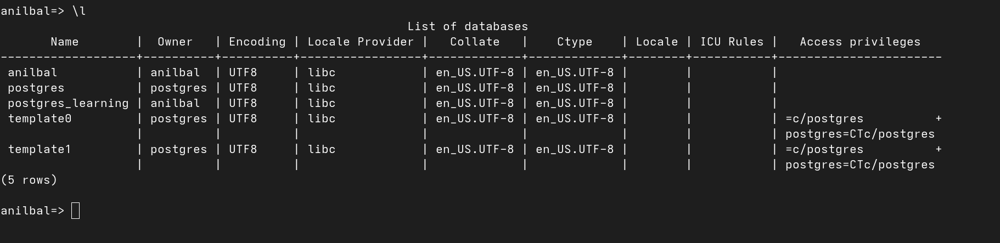

# STEP 1>in your terminal, simple type: psql

Note: psql stands for PostgreSQL Interactive Terminal. It is a command-line program that allows you to communicate with a PostgreSQL database.

# STEP 2>then again type: CREATE DATABASE your_database_name;

Note: The semicolon (;) at the end of the command is required to execute the SQL statement.

Reference image:

