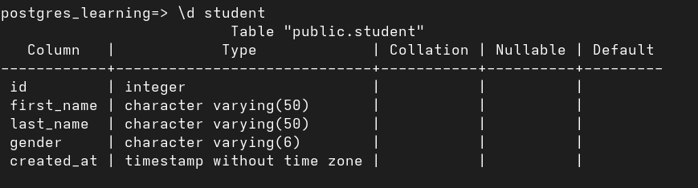

# how to create table without constraints

at first connect your database

```
psql
\c database_name
```

## how to create table

```
postgres_learning=> CREATE TABLE student(
postgres_learning(> id INT,
postgres_learning(> first_name VARCHAR(50),
postgres_learning(> last_name VARCHAR(50),
postgres_learning(> gender VARCHAR(6),
postgres_learning(> created_at TIMESTAMP );
CREATE TABLE
postgres_learning=>

```

## how to see create table

```
postgres_learning=> \d

this is list of tables
```

## how to see create table details

```
postgres_learning=> \d student
```


